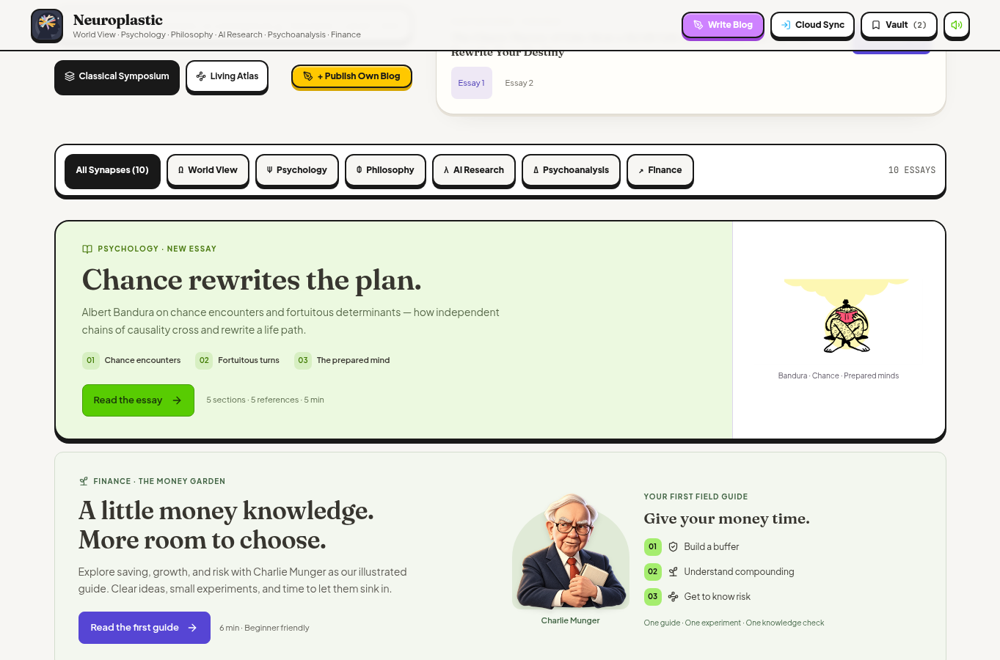
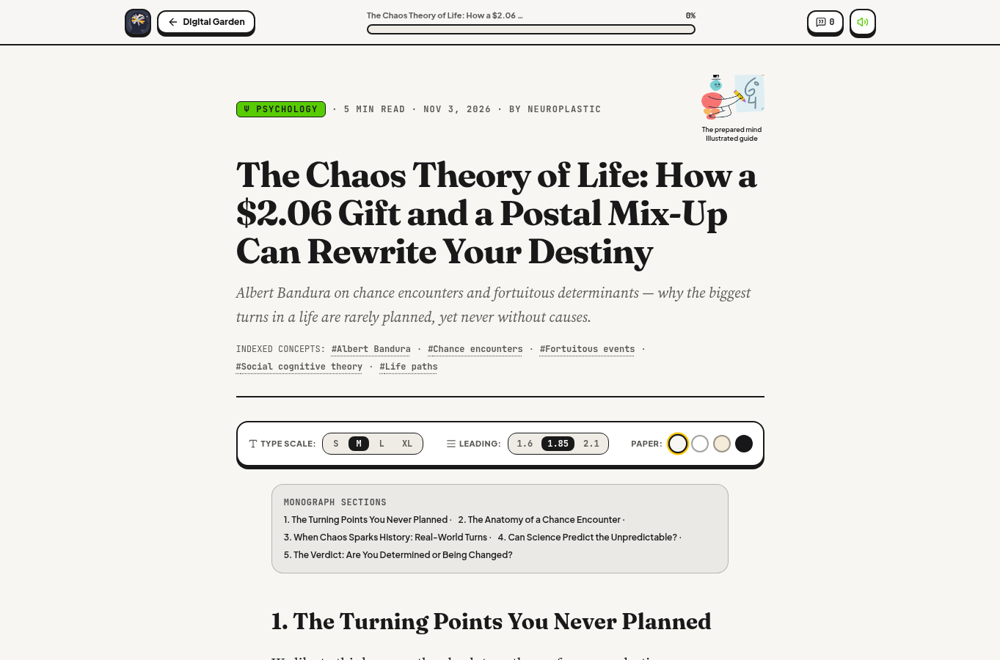
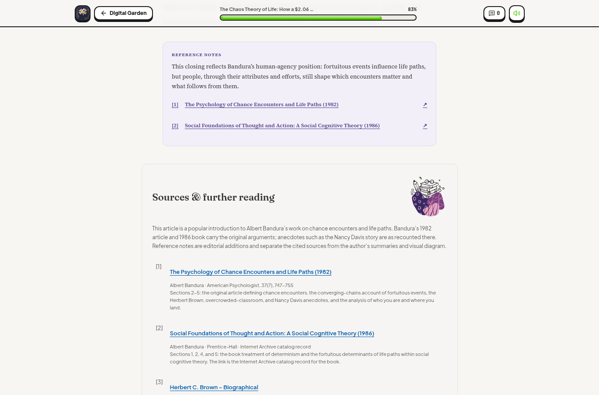

# The Chaos Theory of Life

[Read the article](https://bruce12-glitch.github.io/Neuroplastic/?essay=the-chaos-theory-of-life).

## Editorial treatment

The supplied five sections, the Bandura chance-encounter definition, the two-timeline collision diagram, three real-world anecdotes as bold-led bullets, the two internal subheadings, and the original bold and italic emphasis are retained. An overall title and subtitle were added; the existing site-author byline, Neuroplastic, is used.

The two-timeline ASCII diagram from the source text is rendered as an editorial block quotation with three lines — your timeline, their timeline, and the collision point — because the reader's Markdown allow-list accepts only editorial text elements. The "1. Personal Factors" and "2. Social Environments" enumerations from the source are rendered as internal subheadings so the numbered body headings remain sequential.

Louis Pasteur's prepared-mind line closes its section as a centered pull quote with attribution to the 1854 Lille lecture. Five references and separate editorial notes distinguish Bandura's own texts from the author's summary and diagram.

| Reference | Reading | Context |
| --- | --- | --- |
| 1 | Bandura, *The Psychology of Chance Encounters and Life Paths* (1982) | Chance-encounter definition, converging chains, all three anecdotes, impact analysis |
| 2 | Bandura, *Social Foundations of Thought and Action* (1986) | Determinism and the fortuitous determinants of life paths |
| 3 | NobelPrize.org, *Herbert C. Brown – Biographical* | Sarah's gift of Stock's *The Hydrides of Boron and Silicon* |
| 4 | Brown, Nobel Lecture (1979) | The $2.06 bookstore price for the graduation gift |
| 5 | Wikiquote, *Louis Pasteur* | "Chance favours only the prepared mind," Lille, December 7, 1854 |

## Mascot design

The three supplied illustrations are used as mascots and are encoded losslessly in `public/mascots/readers/` with original dimensions and pixels preserved:

- `pink-book-reader.webp` (713 × 361, from supplied image(20261103).png) — a cross-legged reader absorbed in a pink book inside a warm yellow halo. It introduces the essay in the Psychology reading room, beside the Bandura · Chance · Prepared minds caption.
- `sketching-writer.webp` (321 × 240, from supplied image(20261103).png) — a character sketching a face on paper. It appears in the article metadata area, labelled "The prepared mind", mirroring the Freud article-header guide.
- `book-stack.webp` (307 × 362, from supplied image(20261103).png) — a still life of books, round glasses, and a spotted pencil. It accompanies the sources header with empty alt text because it is decorative, like the blue-reader and red-book-reader bibliographic mascots.

The reading card uses the Psychology pillar tint (#ECF9E0) with the pillar green (#58CC02) call-to-action, three numbered labels for chance encounters, fortuitous turns, and the prepared mind, and reuses the shared reading-room layout. The existing 3D subject guides, custom cursor, and reader controls are retained.

The latest essay is featured under All and Psychology. The previous Psychoanalysis reading card remains available in its subject filter. The direct article link is in README.

## Local verification

TypeScript, the existing test suites, the Firestore rules lint, and the GitHub Pages production build pass with the new data file, reading room, and mascots. The blockquote diagram, pull-quote attribution, and five reference targets were confirmed in the rendered build output.

