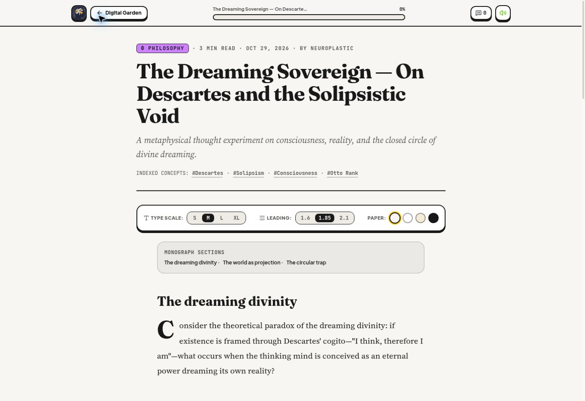
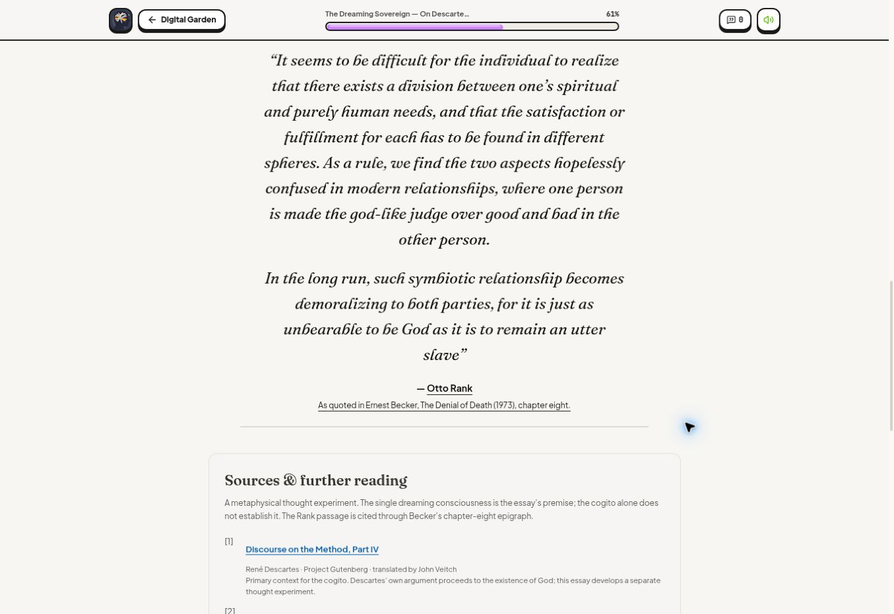

# The Dreaming Sovereign

Published in Philosophy: [The Dreaming Sovereign — On Descartes and the Solipsistic Void](https://bruce12-glitch.github.io/Neuroplastic/?essay=the-dreaming-sovereign).

## Editorial treatment

- The site author's three submitted paragraphs and complete two-paragraph Otto Rank quotation are preserved. Pasted HTML entities, escape characters, and excess whitespace were removed. Section headings and a short card subtitle were added.
- The byline uses the site name, Neuroplastic; no individual author name was supplied.
- The original-essay format opens the full text with reading controls, sources, text selection, and discussion. The existing three-depth learning articles keep their summaries, experiments, quizzes, and XP.
- The supplied Rank author link is retained. The quotation was checked against Ernest Becker's chapter-eight epigraph in *The Denial of Death* (1973), reproduced on [eNotes](https://www.enotes.com/topics/otto-rank/criticism/criticism/ernest-becker-essay-date-1973). Rank's original edition was not inspected. The source note makes the indirect citation clear.
- [Descartes' *Discourse on the Method*, Part IV](https://www.gutenberg.org/cache/epub/59/pg59-images.html) provides primary context for the cogito. The source context distinguishes the essay's dreaming-consciousness premise from Descartes' own conclusions; the submitted argument was not rewritten.
- The direct article link is in README. Other essays also receive shareable `?essay=<slug>` URLs.

## Verification

- TypeScript, 19 existing tests, Firestore rules lint, and the GitHub Pages production build passed.
- Server-render checks confirmed that the original essay includes its text, quotation, attribution, and source links, and that Finance retains its learning controls, compounding experiment, and quiz.
- [PR #7](https://github.com/bruce12-glitch/Neuroplastic/pull/7) merged. GitHub Actions [run 40913498029](https://github.com/bruce12-glitch/Neuroplastic/actions/runs/40913498029) built and deployed successfully.
- Live desktop review at a 1363px viewport confirmed the direct link, refresh, section anchors, Philosophy filter, garden return, browser back/forward, complete quotation, and source links. The garden contains seven essays, including two under Philosophy. No horizontal overflow was detected.
- The existing Finance article was opened through the garden and retained its depth controls, experiment, and knowledge check.
- Screenshots below show the live desktop page. Mobile and tablet viewport checks were not performed in this review.

