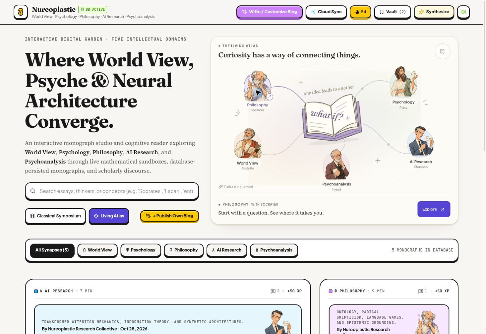

# Living Atlas

The hero opens with a light illustrated atlas in place of the brass WebGL orrery. An original SVG sketchbook connects the five existing thinker portraits. Ink travellers, gently moving portraits, a breathing page, and small drawn stars supply ambient motion while controls and text stay stationary.

Select a thinker to highlight a connection and change the reading invitation. Explore opens the first available essay in that subject. Subject filters also update the atlas. The Classical Symposium remains available as a second view.

The pause control stops every animation in this component. Motion also pauses off screen and in background tabs. The component observes the operating system's reduced-motion preference on first render and when it changes; the CSS media query removes animations and transitions as well. No WebGL canvas, render loop, or new image assets are required.

## Validation

- TypeScript and production build pass.
- All seven existing rules tests pass.
- Desktop browser review and 390px / 768px iframe viewport review completed; no horizontal overflow after the header repair.
- Keyboard subject selection and opening the corresponding AI research essay verified.
- Pause and resume verified using the rendered animation's computed play state.
- Reduced-motion behaviour checked in the implementation; a physical OS preference change was not tested.

