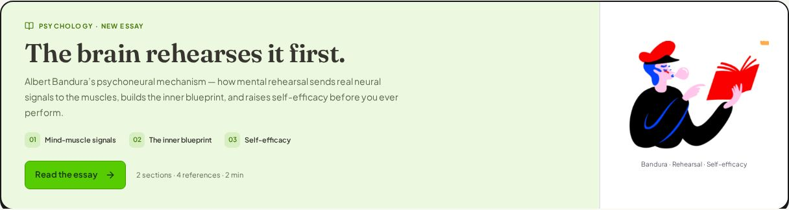
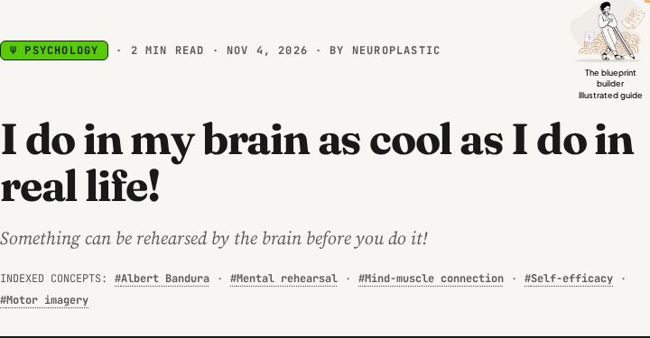
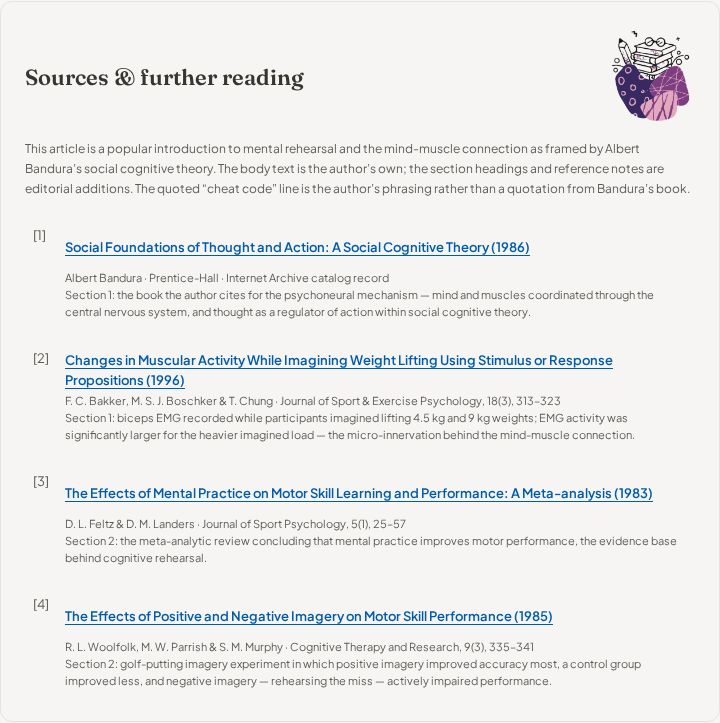

# I do in my brain as cool as I do in real life!

[Read the article](https://bruce12-glitch.github.io/Neuroplastic/?essay=i-do-in-my-brain-as-cool-as-i-do-in-real-life).

## Editorial treatment

The supplied heading and subtitle line become the article title and subtitle, and the two supplied paragraphs of the opening are retained verbatim, including the psychoneural mechanism (mind-muscle connection) framing from Bandura's *Social Foundations of Thought and Action*, the electromyography micro-innervation finding, and the author's quoted "cheat code" line. The supplied "Why Cognitive Rehearsal Works" heading leads the second section with its two paragraphs retained verbatim — the internal-standard blueprint account, the self-efficacy explanation, and the accurate-versus-flawed rehearsal contrast. A derived heading for the opening section keeps the numbered body headings sequential, mirroring the Chaos Theory treatment. The existing site-author byline, Neuroplastic, is used.

The quoted "The stronger your signal and imagination, the stronger you do it in reality" line stays inline exactly as supplied. Because it carries no attribution in the source text, the editorial note records it as the author's own phrasing rather than a quotation from Bandura's book. Four references and separate editorial notes distinguish Bandura's own text from the author's summary and from the empirical studies behind each claim.

| Reference | Reading | Context |
| --- | --- | --- |
| 1 | Bandura, *Social Foundations of Thought and Action* (1986) | The psychoneural mechanism and thought as a regulator of action |
| 2 | Bakker, Boschker & Chung, *JSEP* (1996) | Biceps EMG during imagined 4.5 kg and 9 kg weight lifting |
| 3 | Feltz & Landers, meta-analysis (1983) | Mental practice improves motor performance |
| 4 | Woolfolk, Parrish & Murphy, *CTR* (1985) | Negative imagery — rehearsing the miss — impairs putting |

## Mascot design

The two supplied illustrations are used as mascots and are encoded losslessly in `public/mascots/readers/` with original dimensions and pixels preserved:

- `beret-reader.webp` (316 × 240, from supplied pasted_image_1793769958671.png) — a beret-wearing reader blowing a bubblegum bubble while pointing at the page of a red book. It introduces the essay in the Psychology reading room, beside the Bandura · Rehearsal · Self-efficacy caption, replacing the pink-book reader that introduced the previous Psychology essay.
- `pencil-creator.webp` (297 × 242, from supplied pasted_image_1793769965100.png) — a creator leaning on a giant pencil beside a wireframe sketch, labelled "The blueprint builder". It appears in the article metadata area through a per-essay map with a fallback, so the Chaos Theory essay keeps its prepared-mind sketching writer.

The book-stack still life continues to accompany the psychology sources, as with the Chaos Theory essay. The reading card keeps the Psychology pillar tint (#ECF9E0) with the pillar green (#58CC02) call-to-action, three numbered labels for mind-muscle signals, the inner blueprint, and self-efficacy, and reuses the shared reading-room layout. The existing 3D subject guides, custom cursor, and reader controls are retained.

The latest essay is featured under All and Psychology. The Psychoanalysis and Philosophy reading cards remain in their subject views. The direct article link is in README.

## Local verification

TypeScript and the GitHub Pages production build pass with the new data file, reading-room copy, per-essay header mascot map, and mascots. The four reference targets and the reading-room features (2 sections · 4 references · 2 min) were confirmed in the rendered build output.

