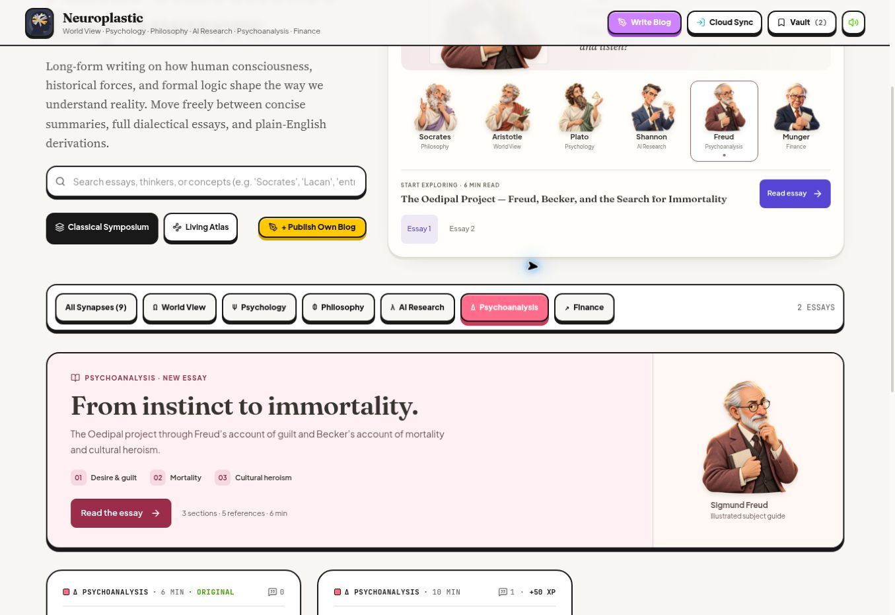
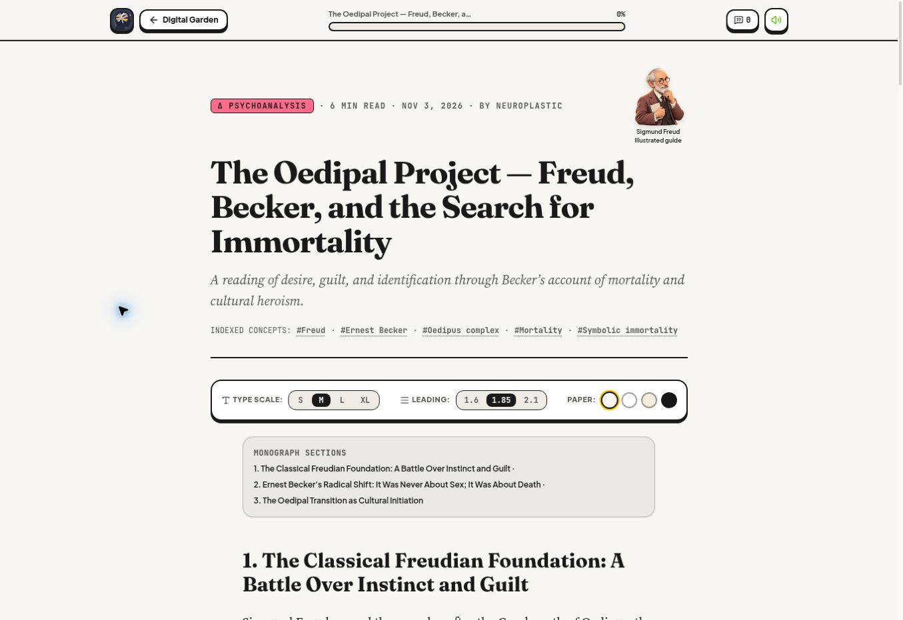
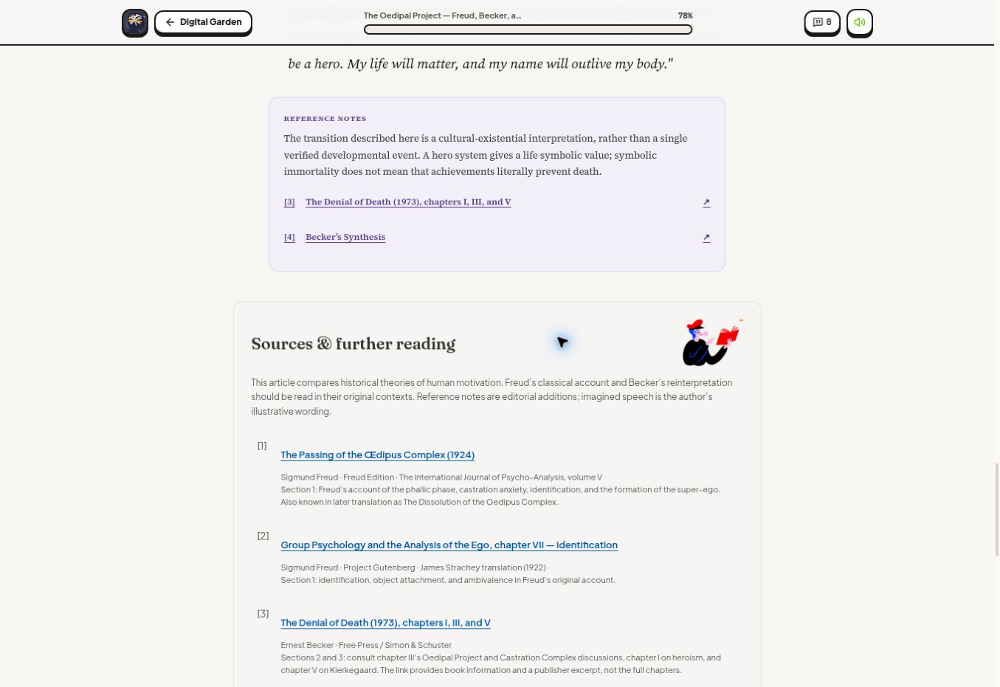

# The Oedipal Project

[Read the article](https://bruce12-glitch.github.io/Neuroplastic/?essay=the-oedipal-project).

## Editorial treatment

The supplied three sections, twelve bullet points, two internal subheadings, and original bold and italic emphasis are retained. An overall title and subtitle were added; the existing site-author byline, Neuroplastic, is used.

The article is an original reading of historical psychoanalytic and existential theories. Five references and separate editorial notes distinguish the source texts from the author's interpretation. The imagined father’s speech and the imagined promise of cultural achievement are identified as explanatory paraphrases, not quotations from Becker. The Becker reference supplies chapter locators and clearly describes the publisher link as book information and an excerpt, rather than free access to all cited chapters.

| Reference | Reading | Context |
| --- | --- | --- |
| 1 | Freud, *The Passing of the Œdipus Complex* (1924) | Historical Oedipal account, identification, super-ego |
| 2 | Freud, *Group Psychology and the Analysis of the Ego*, VII | Identification and ambivalence |
| 3 | Becker, *The Denial of Death* (1973), I, III, V | Heroism, Oedipal project, Kierkegaard |
| 4 | Ernest Becker Foundation, *Becker’s Synthesis* | Introductory secondary reading |
| 5 | APA Dictionary, *Oedipus complex* | Classical terminology and subsequent reassessment |

## Mascot design

The feature uses a pale rose surface and the existing 3D Freud portrait. Three small numbered labels introduce desire and guilt, mortality, and cultural heroism. Freud also appears in the article metadata area, labelled as an illustrated guide.

The supplied image(20261101-160139).png is encoded losslessly as public/mascots/readers/red-book-reader.webp, with its original 316 × 240 dimensions and pixels preserved. It accompanies the Psychoanalysis source header with empty alt text because it is decorative. The existing 3D subject guides and custom cursor are retained.

The latest essay is featured under All and Psychoanalysis. The previous Philosophy reading card remains available in the Philosophy filter. The direct article link is in README.

## Rich author text

The optional section Markdown field preserves headings, lists, and emphasis without changing older paragraph-based essays. The studio loads that field into its existing body editor and preserves edited Markdown on save. It remains inside the existing serialized content payload.

The reader uses pinned react-markdown 10.1.0. Raw HTML is disabled, permitted elements are limited to editorial text, and disallowed wrappers preserve their text. Unsafe URL schemes are sanitized, and external links use noopener/noreferrer. No existing dependency versions were changed.

## Local verification

TypeScript, 21 tests, Firestore rules lint, and the GitHub Pages production build passed. Two new tests cover semantic author formatting and unsafe markup/links. Server-render checks cover all twelve bullet points, both subheadings, the five reference targets, Freud and the red-book reader, the earlier Otto Rank quotation, and Finance controls. The supplied illustration was compared pixel-for-pixel with its encoded asset and confirmed in the build output.

## Deployment and live verification

[PR #9](https://github.com/bruce12-glitch/Neuroplastic/pull/9) merged three focused commits. GitHub Actions [run 41584637223](https://github.com/bruce12-glitch/Neuroplastic/actions/runs/41584637223) built and deployed successfully.

Desktop review at a 1363px viewport confirmed nine essays overall, two under Psychoanalysis, and three under Philosophy. The previous Philosophy feature remains visible in its subject filter. The new article renders three rich-text sections, twelve bullets, two subheadings, eleven bold elements, and five source entries. All section reference links point to existing entries.

Freud's feature portrait loaded and rendered at 174 × 174px; the article header portrait also loaded. The red-book reader loaded at its original 316 × 240 dimensions and displayed correctly beside the sources. The reading-card action worked with Enter. A keyboard source jump moved focus to the selected bibliography entry and displayed its highlight. Refresh and browser back/forward retained the selected article. No horizontal overflow was detected. Mobile and tablet styles were reviewed in CSS but were not exercised in the browser.

