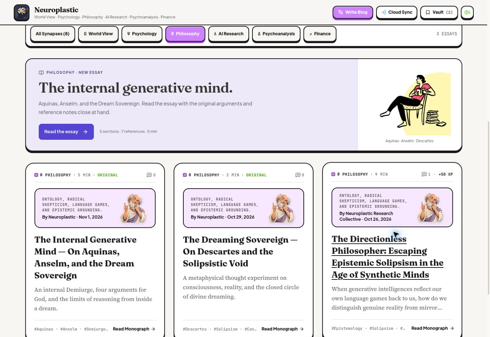
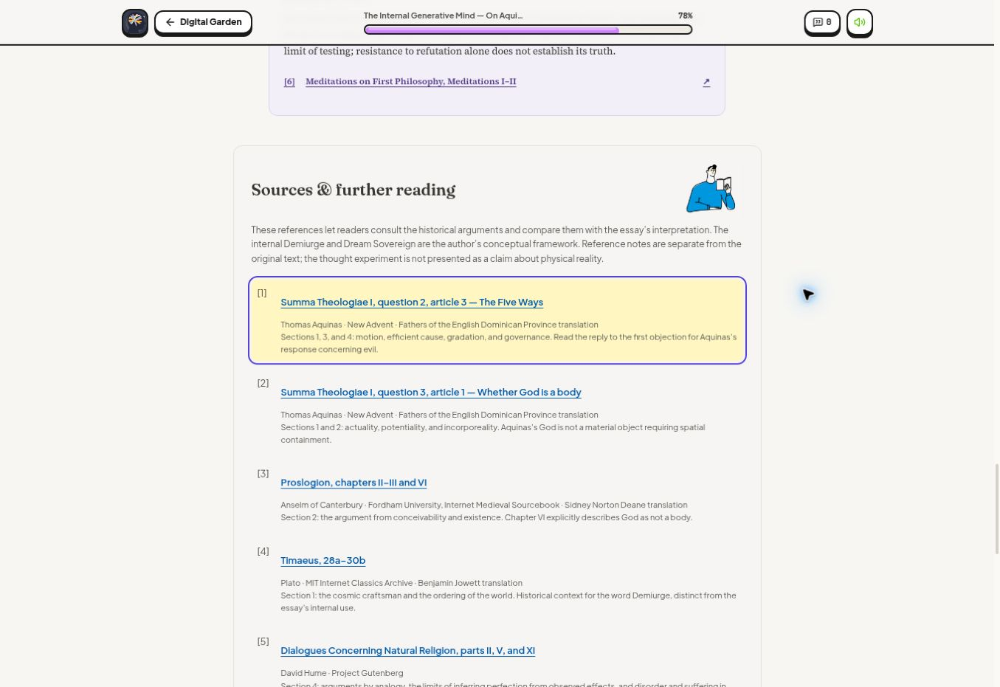

# The Internal Generative Mind & Philosophy reading room

[Read the article](https://bruce12-glitch.github.io/Neuroplastic/?essay=the-internal-generative-mind).

## Article and reference treatment

The site author's five sections and nine body paragraphs are preserved; pasted Markdown emphasis was converted to plain text for the existing reader. An overall title and subtitle were added. The byline uses the existing site-author name, Neuroplastic.

Each section has a separate reference note. Numbered links jump to the corresponding bibliography entry, which receives a visible target highlight. Source context distinguishes the original historical arguments from the author's critiques and hypothetical model. The original-essay format retains reading controls, selection, and discussion.

| Reference | Reading | Relevant sections |
| --- | --- | --- |
| 1 | Aquinas, *Summa Theologiae* I.2.3, the Five Ways | 1, 3, 4 |
| 2 | Aquinas, *Summa Theologiae* I.3.1, actuality and incorporeality | 1, 2 |
| 3 | Anselm, *Proslogion* II–III and VI | 2 |
| 4 | Plato, *Timaeus* 28a–30b | 1 |
| 5 | Hume, *Dialogues Concerning Natural Religion* II, V, XI | 4 |
| 6 | Descartes, *Meditations on First Philosophy* I–II | 5 |
| 7 | NASA Science, *What is Dark Energy?* | 2 |

All seven linked pages were retrieved during source review on November 1, 2026. The first six entries are primary philosophical texts in translation; the seventh supplies modern astronomical context. The source list is for comparison and further reading, rather than an assertion that each source endorses the essay's conclusions.

## Supplied mascot assets

The @Mascot workflow informed the restrained silhouettes, small-size readability, palette, and accessibility treatment. These two user-supplied images were used directly, encoded as lossless WebP with the same pixels and dimensions. No original-art or official Notion affiliation is claimed.

| Supplied file | Repository asset | Use and accessibility |
| --- | --- | --- |
| `image(20261101-154828).png` | `public/mascots/readers/seated-reader.webp` · 404 × 338 | Philosophy card. Alt: “A reader in a pink shirt sitting beside a stack of books.” |
| `image(20261101-160355).png` | `public/mascots/readers/blue-reader.webp` · 309 × 248 | Philosophy bibliography header. Decorative, empty alt text. |

The lavender reading card appears under All and Philosophy, and its counts come from the article data. Native buttons, visible focus, 44px minimum targets, responsive layout rules, and reduced-motion handling follow the existing application. The 3D thinker guides, Finance feature, earlier essay, and custom cursor are retained. The latest article's direct link is in README.

## Local validation

TypeScript, 19 existing tests, Firestore rules lint, and the GitHub Pages production build passed. Server-render checks cover all five sections, seven source targets, invalid/duplicate reference filtering, supplied asset paths, the previous Otto Rank quotation, and the Finance reader controls. Pixel comparison confirmed both encoded illustrations match their supplied originals and are included in the production output.

## Deployment and live review

[PR #8](https://github.com/bruce12-glitch/Neuroplastic/pull/8) merged three focused commits. GitHub Actions [run 41325712303](https://github.com/bruce12-glitch/Neuroplastic/actions/runs/41325712303) successfully built and deployed the site.

The live desktop review at a 1363px viewport confirmed eight essays overall and three in Philosophy, the supplied seated-reader image at its original dimensions, the reading-card action, five reference-note blocks, and seven bibliography entries. Every section reference points to an existing entry. Pressing Enter on a reference moved focus to the entry at 100px below the viewport top and displayed the purple outline and yellow highlight. The blue-reader asset loaded at its original dimensions. The article opened after refresh and through browser history, and no horizontal overflow was detected. Mobile and tablet viewport behavior was reviewed in CSS but was not exercised in the browser.

