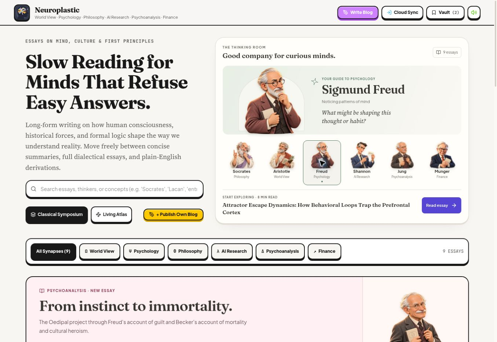
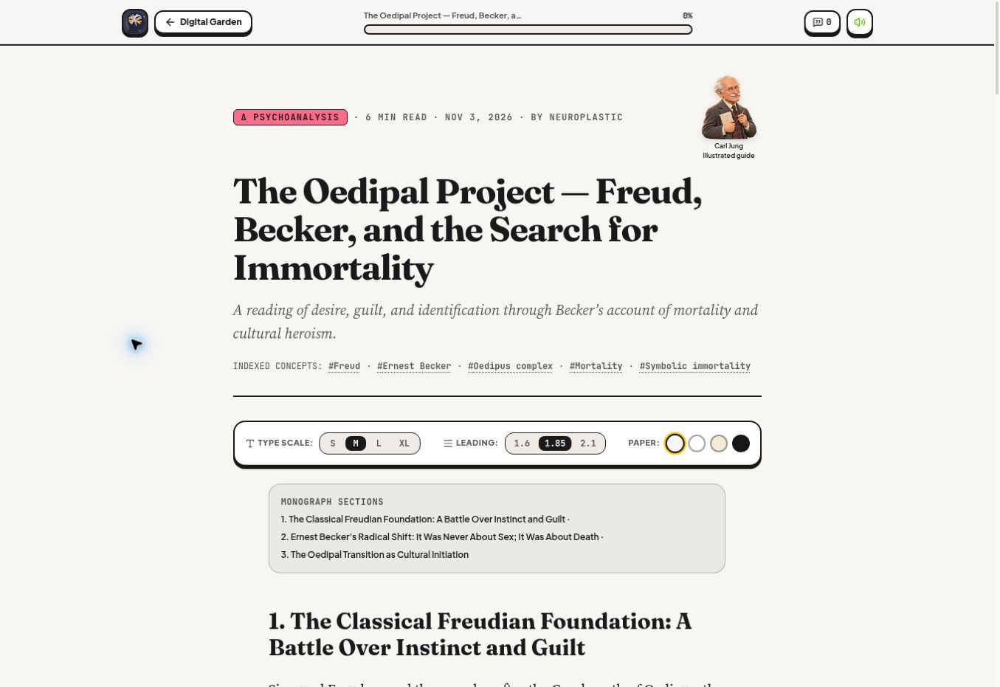

# Psychology and Psychoanalysis guides

[Open Neuroplastic](https://bruce12-glitch.github.io/Neuroplastic/).

On November 3, 2026, the user requested these subject guide assignments:

| Subject | Illustrated guide | Asset |
| --- | --- | --- |
| Psychology | Sigmund Freud | `public/mascots/3d/freud.webp` |
| Psychoanalysis | Carl Jung | `public/mascots/3d/carl-jung.webp` |

The shared portrait configuration controls the gallery, symposium, atlas, article cards, and accessible subject labels. The Psychoanalysis reading feature and original-essay header now derive their captions from the same configuration. This keeps the guide name and portrait synchronized. The author text, article categories, Freud/Becker references, and source notes retain their original content.

## Jung artwork

The built-in image-generation tool produced a new transparent Jung portrait with Freud's existing render as the visual style reference. Jung has swept white hair, a white moustache, a clean-shaven chin, round spectacles, a charcoal tweed suit, a plum waistcoat, and a notebook and pencil. The image is a 3D-rendered portrait with the existing restrained pointer response.

The 1254 × 1254 RGBA output is encoded to WebP at quality 86 with its dimensions and alpha channel preserved. The optimized asset is 255,406 bytes. The exact prompt and reference role are recorded in [carl-jung-prompt.json](carl-jung-prompt.json). The existing Freud asset is reused for Psychology, and Plato's original asset remains archived.

## Verification

TypeScript, all 21 existing tests, Firestore rules lint, and the GitHub Pages production build pass. The built Jung asset retains its 1254 × 1254 dimensions and a full alpha range of 0–255. The source diff is limited to guide configuration, derived captions, artwork, and documentation.

## Deployment and live review

[PR #10](https://github.com/bruce12-glitch/Neuroplastic/pull/10) merged the update in commit `d83c6dcece5f344b22aabef7b375dd0098c23dc1`. GitHub Actions [run 41628706242](https://github.com/bruce12-glitch/Neuroplastic/actions/runs/41628706242) built and deployed successfully. The published code tree matches the locally tested tree, `a888e5c4f5d66f19900a15df83b9f0e6aec2165e`.

At the 1363px desktop viewport, all configured portraits loaded at their original 1254 × 1254 dimensions. Selecting Psychology shows Freud; selecting Psychoanalysis with Enter shows Jung. The gallery's visible labels and accessible subject names match the corrected assignments. Jung also loads in the Living Atlas, the Psychoanalysis reading feature, both Psychoanalysis article cards, and the original article header. The header caption reads “Carl Jung / Illustrated guide.” Freud and Becker remain in the article title, author text, and references. No horizontal overflow was detected in the gallery, atlas, or reader.

Phone and tablet viewport rendering were not exercised in this browser. Existing responsive styles and reduced-motion behavior are unchanged.

